  

  
  
  
  

 

  <b>Currently building</b> · Work Cortex, a personal agent orchestration system <i>(private, phase 1)</i>

 

  
  

  
  
  &nbsp;&nbsp;
  
  

### Teaching

Companion code for my [YouTube](https://www.youtube.com/@ArturSpirin) tutorials on test automation:

| Repo | What it covers | |
|:--|:--|:--|
| [YouTube-Appium-Framework](https://github.com/ArturSpirin/YouTube-Appium-Framework) | Building a mobile automation framework in Java |  |
| [YouTube-WebDriver-Tutorials](https://github.com/ArturSpirin/YouTube-WebDriver-Tutorials) | Selenium WebDriver with Python, step by step |  |

  

